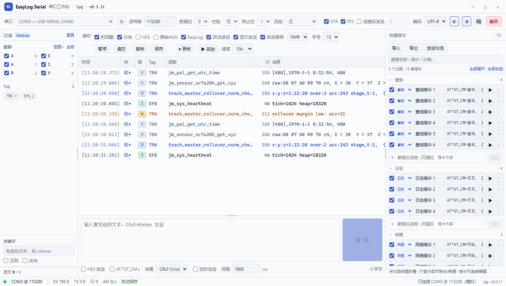

# EasyLog Serial

EasyLogger 的配套串口工作台 · **lyg** · **v0.3.11**。Tauri 2 + React + Rust，Windows 10/11。



## 当前进度

### 第一阶段：SSCOM 核心能力（已跑通）

| 能力 | 状态 |
| --- | --- |
| 串口枚举、热插拔刷新、自定义波特率、数据位/校验/停止位/流控、DTR/RTS | ✅ |
| 文本 / HEX 接收，毫秒时间戳，收←/发→ 方向标记，自动滚动、暂停、清空 | ✅ |
| 复制、保存接收内容 | ✅ |
| 文本 / HEX 发送，行尾 CR/LF/CRLF，Ctrl+Enter，定时发送 | ✅ |
| 快捷指令：单行紧凑列表 + 搜索、多分类列表同时显示/独立折叠/行内移动/新建分类、每个分类末尾预留“新指令”行（添加后自动再留一行）、指令内容可直接编辑、增删改、单条发送、批量发送、导入（txt/JSON/**sscom51.ini**）、导出（JSON）、本地持久化 | ✅ |
| 连接后自动发送激活字符（部分 ASR USB 设备需收到一个字符才开始输出日志） | ✅ |
| 布局可拖拽：日志表头的时间/Tag/函数分隔线、过滤栏右侧、快捷指令左侧、发送区上沿；尺寸会持久化；左右栏可一键隐藏/显示 | ✅ |
| 日志字号 11–18px 可调，行高自动跟随 | ✅ |
| 长行显示：底部横向滚动条，表头随内容一起滚动，不再直接省略超长日志 | ✅ |
| 暗色 / 亮色主题切换：工具栏右侧“亮/暗”按钮，设置持久化 | ✅ |
| ANSI 自动剥离（可切回“原始ANSI”）；即使显示原始转义码，也仍解析级别/Tag/函数，不再出现空白列 | ✅ |
| EasyLog 模式开关：关闭后按 SSCOM 原生方式只显示时间/方向/消息，不解析级别、不按级别着色 | ✅ |
| 原生模式关键字着色：左侧隐藏级别/Tag，改用“关键字 + 颜色”规则，命中整行着色；切回 EasyLog 后恢复级别/Tag | ✅ |
| 自动保存（独立功能）：自动录制为与手动录制相同的 JSONL 格式（含 rx/tx/时间戳），保存在工具目录 `logs\auto`；分段循环覆盖，上限可在 5/10/20/50/100MB 中选择 | ✅ |
| 真实设备联调 | ✅ COM5 @ 115200：勾选“连接后发送 2”后日志开始输出（RX 10.5 KB / 122 行）；发送 `AT^GT_CM=VERSION` 返回 `[VERSION]EL802K_...` |

### 第二阶段：EasyLogger 专属

- [x] 解析 `LEVEL/TAG (line func)` 字段（含无 tag / 无 line-func 变体）
- [x] 整行按级别着色：时间 / Tag / 函数名 / 行号 / 消息统一用级别色（V/D 稍暗）
- [x] 级别复选框、Tag 多选、关键字/正则/反向过滤
- [x] 会话录制与回放（原始 RX/TX，1x / 10x / 立即）
- [ ] 错误快照（最近 30 秒环形缓冲）
- [ ] 重复行折叠 / Minimap

日志格式与解析规则见 [`docs/上位机设计方案.md`](docs/上位机设计方案.md)，可执行规格见 [`tools/elog_parse.py`](tools/elog_parse.py)。

> 过滤栏在左侧：级别复选框控制显示哪些级别；点 Tag 只看该 Tag（可多选）；关键字支持正则与反向。状态栏显示“显示行 / 总行”。

### 录制与回放

- 连接后点 **“● 录制”**，把原始 RX/TX 写入 `文档\EasyLog\sessions\easylog-*.jsonl`；断开或点“停止录制”时落盘
- 点 **“▶ 回放”** 选择会话文件，速度可选 `1x / 10x / 立即`
- 文件是 JSON Lines：`{"type":"meta"...}` + 每条 `{"type":"rx"|"tx","ts":...,"data":"<base64>"}`，可直接用脚本分析
- 回放会重建时间戳、方向、级别/Tag，并重新走一遍过滤与着色

### ASR USB 设备：连接后激活日志

部分 ASR USB 设备（如 COM5 的 ASR Modem）上电后不会主动输出日志，必须先收到一个字符。

- 工具栏勾选 **“连接后发送”**，填一个字符（默认 `2`，支持 `\r` `\n` `\xNN` 转义）
- 连接成功后 250ms 自动发送一次；按发送框“结尾”追加换行（默认 CRLF，和 SSCOM 的“发送新行”一致）。设备只要单字节时，把结尾设为 **无**
- 设置会持久化，下次连接继续生效；不勾选则完全不影响其他设备

### 拖动调整布局

- 日志表头：拖动 **时间 / Tag / 函数** 右边的分隔线调整列宽（函数列 120–600px）
- 左右面板：拖动过滤栏右边、快捷指令栏左边的竖线调整宽度
- 发送区：拖动发送区上沿的横线调整高度
- 长日志行不再用省略号截断，拖动底部横向滚动条可看完整内容，表头会一起移动
- 顶部工具栏 `◧` / `◨` 可隐藏或显示左侧过滤栏、右侧快捷指令栏
- 接收工具栏固定为两行：第一行显示选项，第二行操作按钮；隐藏侧栏时不会跨行乱跳
- 日志字号可在接收工具栏“字号”里选择 11–18px，行高和各列宽度自动跟随
- 所有尺寸写入 `localStorage`，下次打开保持

### 主题

- 工具栏“编码”右侧有 **“亮/暗”** 切换按钮
- 亮色主题会同时调整日志级别色、过滤栏、快捷指令、发送区、表头和滚动条
- 主题选择写入 `localStorage`，下次启动保持


### EasyLog / 原生 SSCOM 显示

- 勾选 **EasyLog**：解析 `LEVEL/TAG (line func)`，显示级别、Tag、函数、行号，并按级别整行着色
- 取消 **EasyLog**：切换成 SSCOM 原样模式，只保留时间 / 方向 / 消息，不解析字段、不按级别着色
- **原始ANSI**：关闭时先剥离 ANSI 再入库；开启时保留原始文本（复制/保存用），但解析仍按剥离后的内容进行，不会出现函数名为空的列
- 取消 EasyLog 后，左侧过滤栏会隐藏 **级别 / Tag**（它们只对 EasyLog 格式有意义），只保留关键字过滤
- 原生模式下新增 **“关键字颜色”**：可添加多条 `关键字 + 颜色`，不区分大小写，命中后整行着色；按添加顺序取第一条匹配规则
- 颜色规则保存在 `localStorage`；切回 EasyLog 后这些规则不参与着色，级别/Tag 恢复

### 自动保存（独立功能）

- 默认开启，自动记录**接收 + 发送**；和手动“保存”、手动“录制”互不影响
- 位置：`工具目录\logs\auto\auto-000001.jsonl`（和 `EasyLogSerial.exe` 同级）
- 格式与手动录制完全相同：`meta` + 每段 `rx`/`tx` + `ts` 毫秒时间戳 + base64 data，可直接用“回放”打开
- 每段 1 MB，默认上限 10 MB；工具栏“自动保存”右侧可选 `5/10/20/50/100MB`，超过上限自动删除最旧分段
- 状态栏只显示“自动保存 / 自动保存 关”状态
- 手动“保存”和“录制”仍然由用户自己触发，路径/行为不变

### 快捷指令多分类列表

- 默认同时显示所有分类列表；每个分类标题可独立折叠/展开
- 顶部提供 **全部展开 / 全部收起**，不会用单选筛选把其他分类藏起来
- 每条指令行首是分类下拉：选已有分类，或选 **“＋ 新建…”** 输入新分类
- 新建分类后该指令立即移入；导入/导出 JSON 会保留 `category`
- 每个分类末尾固定有一行 **“＋ 新指令”**：填名称和内容后按回车或点“添加”，指令立即进入该分类，并自动再留一行空行继续添加
- “发送勾选”只发送当前搜索/列表中打勾的指令

### 发送 AT 前缀

- 下发文本框底部可勾选 **`AT^GT_CM=`**，之后文本框里只输入 `VERSION`，发送时自动变成 `AT^GT_CM=VERSION`
- 只影响从下发文本框发出的内容（手动发送 / Ctrl+Enter / 定时发送），不改快捷指令本身
- 内容已带 `AT^GT_CM=` 时不会重复添加；HEX 模式禁用该选项
- 文本框下方的“+ 快捷指令”按钮已移除，新增指令统一在快捷指令分类末尾添加

## 快捷指令导入格式

### SSCOM 配置（推荐）

直接选择 SSCOM 目录下的 `sscom51.ini` 即可。解析规则：

```
N1=A,AT^GT_CM=VERSION      # 第 1 条：A=ASCII，H=HEX
N101=0,查询版本号,1000      # 第 1 条的元数据：?, 名称, 延时(ms)
```

- 自动按 GBK 解码（UTF-8 文件会自动识别）
- 自动配对 `N1..N99` 与 `N101..N199`，读取名称与每条的延时
- 导入的指令默认标为 **“跟随”**：发送时使用发送框“结尾”里的 CR/LF/CRLF；旧版本导入的 `append=none` 指令会在启动时自动迁移
- **重复导入同一份 `sscom51.ini` 会按名称更新，不会变成 192 条**（状态栏显示“新增 X，更新 Y”）
- 已用一份真实的 SSCOM 配置验证：**96 条指令全部导入**。SSCOM 在 ini 里用 `0x02` 转义逗号，导入时会还原成 `,`（如 `AT^GT_CM=LOG\x02255` → `AT^GT_CM=LOG,255`）；旧版本已导入的指令也会在启动时自动修正
- 导入时可按 `分类` 字段（JSON）保留分类；SSCOM/txt 导入默认放入“未分类”，之后可在行首下拉里移动或新建分类

### 文本（`.txt`，一行一条）

```
# 注释
重启<TAB>reset\r\n
查询版本|ver
HEX: 01 03 00 00 00 01 84 0A
AT+CSQ
```

- `名称<TAB>指令` 或 `名称|指令`；不写名称时自动截取指令前 24 字符
- `HEX:` 前缀表示十六进制发送
- 文本指令支持 `\r` `\n` `\t` `\xNN` 转义
- 也支持导入本工具导出的 JSON（`{ version, commands: [...] }`）

> SSCOM 没有单独的“导出”按钮，直接选它目录下的 `sscom51.ini` 即可；文件里 `N1051` 之后的全局设置目前不导入。

## 直接运行（免安装）

免安装绿色版：[`release/EasyLog-Serial-0.3.11-portable.zip`](release/EasyLog-Serial-0.3.11-portable.zip)（约 1.9 MB）

- 解压到任意文件夹，双击 `EasyLogSerial.exe` 即可
- 按住自定义标题栏空白处可拖动整个窗口；四边/四角可缩放
- 必须同时保留 `WebView2Loader.dll`，不能只拷 exe
- 需要 WebView2 Runtime（Windows 10/11 一般已自带）
- 自动录制写在解压目录的 `logs\auto` 下；整个文件夹可以直接拷走使用

> 不提供安装版；本项目只发布免安装便携包。

## 源码构建

### 推荐：MSVC 工具链

1. 安装 Rust（MSVC toolchain）、Visual Studio Build Tools（“使用 C++ 的桌面开发”）、WebView2 Runtime（Win10/11 一般自带）
2. `pnpm install`
3. `pnpm tauri dev` 开发，`pnpm tauri build` 构建可执行文件

### 本机：GNU 工具链（无 MSVC 时的可用路径）

本仓库当前是在没有 Visual Studio 的机器上，用 **Rust GNU + w64devkit** 构建的：

```powershell
$env:PATH = "$env:USERPROFILE\.cargo\bin;$env:USERPROFILE\tools\w64devkit\bin;$env:PATH"
node node_modules/vite/bin/vite.js build
cd src-tauri

# 开发/自用
cargo build
.\target\debug\easylog-serial.exe

# 发布（必须带 custom-protocol，否则会以 dev 模式去连 localhost:1420，脱离 Vite 后白屏）
cargo build --release --features custom-protocol
# 产物：target/release/easylog-serial.exe + WebView2Loader.dll（两者必须放一起）
```

四个 GNU 特有的坑（已处理）：

- `Cargo.toml` 的 `crate-type` 改为 `["rlib"]`：`cdylib` 在 GNU 下会因导出符号超过 65535 个报 `export ordinal too large`。
- 发布构建必须加 `--features custom-protocol`（`Cargo.toml` 里已定义 `custom-protocol = ["tauri/custom-protocol"]`），否则 exe 是 dev 模式，加载 `http://localhost:1420`。
- GNU 产物动态依赖 `WebView2Loader.dll`（MSVC 产物通常静态链接），分发时必须和 exe 放在同一目录。
- w64devkit 的 GCC 16 不再提供 `libgcc_eh.a`，Rust GNU 目标仍会 `-lgcc_eh`；在 `w64devkit/lib/gcc/x86_64-w64-mingw32/<ver>/` 下创建一个空归档即可：

  ```powershell
  ar rcs libgcc_eh.a
  ```

## 目录

```
src/                      React 界面
  components/             工具栏、日志视图、发送区、快捷指令、过滤栏、状态栏
  lib/                    EasyLogger 解析、过滤、ANSI/HEX、会话、快捷指令、串口桥接
  App.tsx                 状态与串口事件编排
src-tauri/
  src/serial.rs           串口管理器（读线程、事件、背压、会话录制）
  src/lib.rs              Tauri 命令注册
docs/
  串口工具调研报告.md      市场调研
  上位机设计方案.md        功能清单、架构、解析规格、里程碑
  samples/                真实设备抓包（parser 回归用）
tools/
  elog_parse.py           EasyLogger 行解析器（参考实现）
```

## 测试

```powershell
node node_modules/vitest/vitest.mjs run        # 39 个前端单测
python tools/elog_parse.py --selftest          # 解析器自测
```

真实抓包回归：

```powershell
python tools/elog_parse.py docs/samples/device-115200.txt
# total=117 parsed=91 ignored=26 unparsed=0
```

> `ignored` 是设备消息自带 `\r\n` 时单独成行的 ANSI 复位码（`ESC[0m`），不是解析失败。
